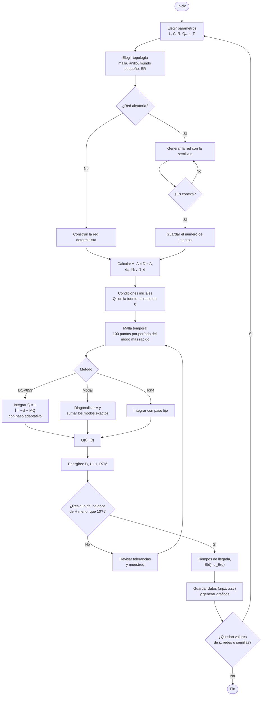
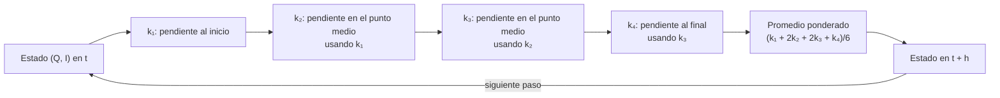
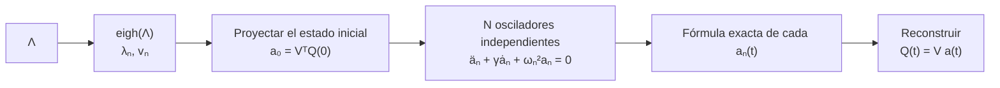
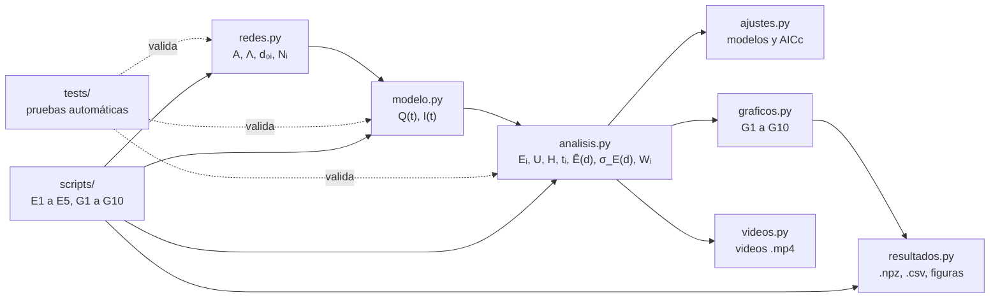

# Pseudocódigo y diagrama de flujo

Este documento explica la lógica del programa sin depender de Python: qué
hace cada parte, en qué orden y qué ecuación de la teoría implementa. Es el
entregable «Pseudocódigo y diagrama de flujo» de la Fase 2 y respalda el
criterio de evaluación «Programación y lógica».

Las referencias del tipo «teoría 4.7» remiten al documento de la Fase 1
(`Fase 1 teoría del modelo RLC.pdf`): punto 4, paso 7. Las del tipo «ec. (13)»
remiten al enunciado del PDF.

## 1. Relación entre ecuaciones y código

| Ecuación | Origen | Dónde está en el código |
|----------|--------|-------------------------|
| Λ = D − A | Teoría 4.5 | `redes.laplaciano` |
| d₀ᵢ y Nᵢ (búsqueda en anchura) | Teoría 7.6 | `redes.distancias_y_caminos` |
| γ = R/L, ω₀² = 1/(LC), K = κω₀² = 1/(LC_c) | Teoría 1.4 y 3.8 | `modelo.Parametros` |
| M = ω₀²𝕀 + KΛ | Teoría 7.1 | `modelo.matriz_rigidez` |
| Q̇ = I, İ = −γI − MQ | Teoría 4.7 | `derivadas` en `modelo.integrar_dop853` y `pendiente` en `modelo.integrar_rk4` |
| Q(0) = Q₀ en la fuente, el resto en 0; I(0) = 0 | Ec. (11)–(12) | `modelo.condiciones_iniciales` |
| Λvₙ = λₙvₙ, ωₙ² = ω₀² + Kλₙ, Ωₙ² = ωₙ² − γ²/4 | Teoría 6.1–6.6 | `modelo.modos_normales` |
| aₙ(t) del oscilador amortiguado | Teoría 2.10 y 6.6 | `modelo.solucion_modal` |
| Eᵢ = Qᵢ²/(2C) + LIᵢ²/2 | Ec. (13) | `analisis.energia_nodos` |
| U = (LK/2)QᵀΛQ | Teoría 5.3 | `analisis.energia_acoplamiento` |
| H = ΣEᵢ + U, dH/dt = −RΣIᵢ² | Teoría 5.4 y 5.10 | `analisis.Energias.H`, `residuo_balance` |
| Pᵢ = −LK Iᵢ(ΛQ)ᵢ | Teoría 5.7 | `analisis.potencia_intercambio` |
| H(0) = E₀(1 + k₀κ) | Teoría 5.12 | `analisis.energia_inicial` |
| ⟨Eᵢ⟩ = (1/T)∫Eᵢ dt | Ec. (16) | `analisis.energia_media` |

## 2. Diagrama de flujo general

Muestra el recorrido de los datos en un experimento, desde los parámetros
hasta los resultados. Todos los bloques están programados; los experimentos
E2 y E5 recorren las combinaciones de κ, redes y semillas en paralelo.



**Regla del proyecto:** ningún resultado se analiza antes de que pasen las
pruebas automáticas (`python -m pytest`). La comprobación del balance de H
dentro del flujo es la misma idea aplicada a cada simulación.

## 3. Pseudocódigo por módulo

### 3.1 Construcción de la red (`redes.py`)

```text
ALGORITMO ConstruirRedAleatoria(generador, semilla, fuente, max_intentos)
    rng ← GeneradorAleatorio(semilla)          // un solo generador → reproducible
    PARA intento ← 1 HASTA max_intentos HACER
        G ← generador(rng)                     // Watts–Strogatz o Erdős–Rényi
        SI G es conexa ENTONCES
            DEVOLVER CrearRed(G, fuente, semilla, intento)
        FIN SI
    FIN PARA
    ERROR "No se obtuvo una red conexa"
FIN ALGORITMO

ALGORITMO CrearRed(G, fuente, semilla, intentos)
    VERIFICAR que G no tiene autoenlaces y que sus nodos son 0..N−1
    A ← matriz de adyacencia de G              // Aᵢⱼ = 1 si hay enlace
    (d, Ncam) ← DistanciasYCaminos(G, fuente)
    DEVOLVER Red(G, fuente, A, d, Ncam, semilla, intentos)
FIN ALGORITMO

ALGORITMO Laplaciano(A)
    D ← matriz diagonal con los grados kᵢ = Σⱼ Aᵢⱼ
    DEVOLVER D − A                              // teoría 4.5
FIN ALGORITMO
```

### 3.2 Distancias y número de caminos más cortos (`redes.py`)

Es una búsqueda en anchura (BFS). Avanza por capas: primero los vecinos de la
fuente (d = 1), luego los vecinos de esos (d = 2), y así sucesivamente. Cada
nodo hereda los caminos de todos sus vecinos de la capa anterior.

```text
ALGORITMO DistanciasYCaminos(G, fuente)
    PARA cada nodo i HACER  d[i] ← −1;  Ncam[i] ← 0  FIN PARA
    d[fuente] ← 0;  Ncam[fuente] ← 1
    frontera ← [fuente]
    MIENTRAS frontera no esté vacía HACER
        siguiente ← []
        PARA cada u EN frontera HACER
            PARA cada vecino v DE u HACER
                SI d[v] = −1 ENTONCES          // primera vez que se llega a v
                    d[v] ← d[u] + 1
                    AGREGAR v A siguiente
                FIN SI
                SI d[v] = d[u] + 1 ENTONCES    // u está en un camino más corto a v
                    Ncam[v] ← Ncam[v] + Ncam[u]
                FIN SI
            FIN PARA
        FIN PARA
        frontera ← siguiente
    FIN MIENTRAS
    DEVOLVER d, Ncam                            // d = −1 indica "no alcanzable"
FIN ALGORITMO
```

### 3.3 Sistema de ecuaciones (`modelo.py`)

```text
DATOS: γ = R/L,  ω₀² = 1/(LC),  K = κ ω₀²,  M = ω₀² 𝕀 + K Λ

FUNCIÓN Derivadas(Q, I)                         // teoría 4.7
    dQ ← I
    dI ← −γ · I − M · Q
    DEVOLVER (dQ, dI)
FIN FUNCIÓN
```

### 3.4 Integración con DOP853 (`modelo.py`)

DOP853 pertenece a SciPy. El código del proyecto le entrega las derivadas, las
tolerancias y los instantes donde se quiere la solución. Por dentro ajusta el
paso: compara dos estimaciones de distinto orden y achica el paso si la
diferencia supera la tolerancia, o lo agranda si sobra precisión.

```text
ALGORITMO IntegrarDOP853(Λ, parámetros, t, Q_ini, I_ini)
    y₀ ← (Q_ini, I_ini)                         // 2N incógnitas
    atol ← (10⁻¹² · Q₀ para cada Q,  10⁻¹² · ω_max · Q₀ para cada I)
    rtol ← 10⁻¹⁰
    sol ← RESOLVER y' = Derivadas(y) DESDE t[0] HASTA t[fin]
              con DOP853, rtol, atol, guardando en los instantes t
    SI sol no tuvo éxito ENTONCES ERROR FIN SI
    DEVOLVER Q(t), I(t)
FIN ALGORITMO
```

**Por qué la tolerancia absoluta se escala:** Q (≈ 10⁻⁶ C) e I (≈ 10⁻² A)
tienen órdenes de magnitud distintos. Una sola tolerancia sería demasiado
laxa para una y demasiado estricta para la otra.

### 3.5 Integración con RK4 propio (`modelo.py`)

```text
ALGORITMO IntegrarRK4(Λ, parámetros, t, Q_ini, I_ini, subpasos)
    h ← (t[1] − t[0]) / subpasos
    (Q, I) ← (Q_ini, I_ini);  GUARDAR (Q, I) en t[0]
    PARA n ← 1 HASTA número de instantes − 1 HACER
        REPETIR subpasos VECES
            k₁ ← Derivadas(Q, I)
            k₂ ← Derivadas((Q, I) + h/2 · k₁)
            k₃ ← Derivadas((Q, I) + h/2 · k₂)
            k₄ ← Derivadas((Q, I) + h · k₃)
            (Q, I) ← (Q, I) + h/6 · (k₁ + 2k₂ + 2k₃ + k₄)
        FIN REPETIR
        GUARDAR (Q, I) en t[n]
    FIN PARA
    DEVOLVER Q(t), I(t)
FIN ALGORITMO
```



### 3.6 Solución exacta por modos normales (`modelo.py`)

```text
ALGORITMO SolucionModal(Λ, parámetros, t, Q_ini, I_ini)
    (λ, V) ← autovalores y autovectores de Λ   // Λ simétrica → eigh, teoría 6.1
    PARA cada modo n HACER
        ωₙ² ← ω₀² + K λₙ                         // teoría 6.4
        Ωₙ² ← ωₙ² − γ²/4
    FIN PARA
    a₀ ← Vᵀ Q_ini;  b₀ ← Vᵀ I_ini               // coordenadas modales iniciales
    PARA cada instante t HACER
        PARA cada modo n HACER
            SI Ωₙ² > 0 ENTONCES                  // subamortiguado (caso del proyecto)
                C ← e^(−γt/2) cos(Ωₙ t);   S ← e^(−γt/2) sen(Ωₙ t)/Ωₙ
            SI NO, SI Ωₙ² < 0 ENTONCES           // sobreamortiguado
                C ← e^(−γt/2) cosh(βt);    S ← e^(−γt/2) senh(βt)/β,  β = √(−Ωₙ²)
            SI NO                                // crítico
                C ← e^(−γt/2);             S ← t · e^(−γt/2)
            FIN SI
            aₙ(t)  ← a₀ₙ C + (b₀ₙ + γ/2 · a₀ₙ) S
            ȧₙ(t)  ← b₀ₙ C − (γ/2 · b₀ₙ + ωₙ² a₀ₙ) S
        FIN PARA
        Q(t) ← V a(t);   I(t) ← V ȧ(t)          // volver a los nodos, teoría 6.7
    FIN PARA
    DEVOLVER Q(t), I(t)
FIN ALGORITMO
```



### 3.7 Simulación completa (`modelo.simular`)

```text
ALGORITMO Simular(red, parámetros, método, T)
    Λ ← Laplaciano de la red
    SI T no se indicó ENTONCES T ← 10/γ FIN SI
    ω_max ← √(ω₀² + K λ_max)                    // modo más rápido
    t ← instantes equiespaciados en [0, T], 100 por período 2π/ω_max
    (Q_ini, I_ini) ← CondicionesIniciales(N, fuente, Q₀)
    SEGÚN método HACER
        "dop853": (Q, I) ← IntegrarDOP853(Λ, parámetros, t, Q_ini, I_ini)
        "modal":  (Q, I) ← SolucionModal(Λ, parámetros, t, Q_ini, I_ini)
        "rk4":    (Q, I) ← IntegrarRK4(Λ, parámetros, t, Q_ini, I_ini, subpasos)
    FIN SEGÚN
    DEVOLVER Simulacion(t, Q, I, Λ, parámetros, fuente)
FIN ALGORITMO
```

### 3.8 Energía y balance (`analisis.py`)

```text
ALGORITMO Energias(sim)
    PARA cada instante t y cada nodo i HACER
        Eᵢ(t) ← Qᵢ²/(2C) + L Iᵢ²/2                // ec. (13)
    FIN PARA
    PARA cada instante t HACER
        U(t) ← (L K / 2) · Q(t)ᵀ Λ Q(t)          // energía en los C_c
        P(t) ← R · Σᵢ Iᵢ(t)²                     // calor disipado por unidad de tiempo
        H(t) ← Σᵢ Eᵢ(t) + U(t)                   // energía total
    FIN PARA
    DEVOLVER E, U, P, H
FIN ALGORITMO

ALGORITMO ResiduoBalance(t, H, P)
    Disipada(t) ← ∫₀ᵗ P dt'                     // regla de Simpson acumulada
    DEVOLVER [H(t) + Disipada(t) − H(0)] / H(0) // ≈ 0 si dH/dt = −RΣIᵢ²
FIN ALGORITMO
```

### 3.9 Validación (`tests/`)

```text
ALGORITMO Validar
    PARA cada prueba del plan HACER             // 9 pruebas, más otras adicionales
        ejecutar el caso (K = 0, R = 0, N = 2, red completa, ...)
        comparar con la solución exacta o con la propiedad esperada
        SI el error supera el criterio ENTONCES
            REPORTAR fallo;  DETENER el análisis de resultados
        FIN SI
    FIN PARA
    REPORTAR "todas las pruebas aprobadas"
FIN ALGORITMO
```

## 4. Diagrama de módulos

Muestra qué módulo usa a cuál. Las flechas van del módulo que entrega datos al
que los recibe. Todos los módulos están programados.



## 5. Cómo usar este documento en el informe y la exposición

- **Informe, sección de método:**
  - el diagrama general de la sección 2;
  - la tabla de la sección 1;
  - el pseudocódigo de RK4 y de la solución modal.
- **Exposición, diapositiva «Método»:**
  - el diagrama general;
  - el ciclo de RK4, para explicar qué hace un integrador.
- **Defensa individual:** cada integrante debe poder recorrer el diagrama
  general y explicar qué ecuación se aplica en cada bloque.

Para insertar los diagramas como imagen en Word o en las diapositivas, se
puede copiar cada bloque `mermaid` en <https://mermaid.live> y exportarlo como
PNG o SVG.
